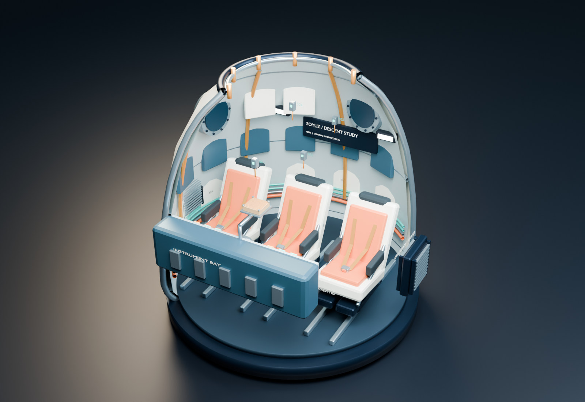
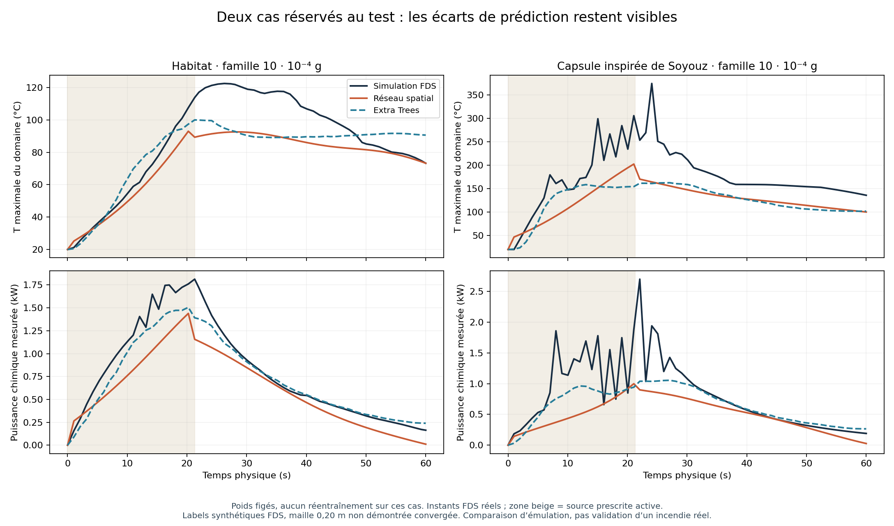

# IGNIS 3D — Valley

Application de recherche pour le challenge NASA **Flame in Freefall** : explorer
des scènes 3D, comparer gravité terrestre et microgravité, générer des simulations
reproductibles et consulter les observations expérimentales NASA pertinentes.

La version livrée fonctionne sur le PC Windows de Thomas, avec **deux modèles
réellement entraînés et préchargés**. L’interface et les calculs utilisent ce PC ;
le VPS conserve le code et les preuves légères.

## Ouvrir l’application

- Sur le PC : <http://127.0.0.1:8765>.
- Depuis le réseau Tailscale : <https://desktop-m4hkr86.tail609f26.ts.net:8443>.
- Le PC doit être allumé, connecté à Tailscale et le service démarré.

Après un redémarrage de Windows, lancer dans PowerShell :

```powershell
powershell.exe -NoProfile -ExecutionPolicy Bypass -File E:/IGNIS-Valley/app/tools/windows/start-ignis.ps1
```

Le [guide Windows](docs/WINDOWS.md) décrit l’arrêt, les fichiers, la reconstruction,
les commandes d’entraînement et les vérifications. Il n’y a pas de lancement
automatique à l’ouverture de session.

## Fonctionnalités livrées

- **Quatre scènes Blender détaillées** : habitat, cargo, ventilation transversale
  et capsule inspirée de Soyouz. Fichiers `.blend`, GLB, proxies physiques,
  matériaux, bouches et capteurs ; [import d’un modèle annoté](docs/SCENES.md).
- **FDS 6.11.1 exécuté sur CPU** : transport depuis une source prescrite,
  échauffement et pyrolyse couplés, source thermique ou chauffage électrique
  résistif I²R. Gravité, ventilation, oxygène, matériau et source sont réglables.
- **Visualisation interactive** : objets sélectionnables, champs échantillonnés
  de température, oxygène, suies et vitesse, chronologie, courbes et comparaison.
- **Campagnes de 2 à 100 scénarios** : graine, plages de paramètres, file persistante,
  annulation, provenance et exports JSON/CSV/Parquet.
- **Deux modèles préchargés** : réseau spatial PyTorch et référence Extra Trees.
  Les poids et les scènes sont contrôlés par empreinte ; les requêtes hors domaine
  sont refusées. Entraînement CUDA réalisé sur RTX 4070 Ti.
- **Observations NASA traçables** : tables BASS-II, BASS et Saffire-I archivées,
  classement selon des critères visibles et interprétation par **Codex** avec
  citations. IGNIS n’appelle pas Ollama.



## Données et résultats mesurés

Le pilote comprend **96 simulations FDS et 5 800 instants**, répartis en
48 calculs d’entraînement, 12 de validation et 36 de test. Les familles complètes
restent dans une seule partition ; la géométrie crossflow est réservée au test.
Les données et les poids sont conservés sur Windows, hors Git.

| Mesure sur les 36 calculs de test | Réseau spatial | Extra Trees |
|---|---:|---:|
| Erreur absolue moyenne de température maximale | 8,06 °C | 6,65 °C |
| Erreur absolue moyenne du pic par calcul | 26,53 °C | 21,37 °C |
| Erreur absolue moyenne de puissance chimique | 150,55 W | 81,71 W |

Les [résultats complets](docs/MODELS.md) publient aussi les erreurs locales,
par scène et par gravité. Les pics Soyouz en microgravité sont mal reproduits.
Le réseau peut donner une température moyenne ou locale supérieure à son maximum
global prédit : il sert à la prévisualisation exploratoire.



## Portée scientifique

Les modèles apprennent à reproduire **les simulations FDS**, avec un maillage
de 0,20 m dont la convergence n’est pas démontrée. Ils ne sont pas entraînés sur
des champs de flamme NASA. Les tables NASA importées et la calibration du
ventilateur BASS-II apportent des références documentaires et instrumentales ;
elles ne valident pas la combustion simulée.

La prédiction apprise couvre seulement le transport d’une source prescrite,
à 10⁻⁴ g ou 1 g, dans les quatre géométries et plages publiées. Le solveur propose
en plus un mode couplé expérimental. Les matériaux sont génériques ; les arcs
électriques, le plasma, l’emballement de batteries et les systèmes de ventilation
fermés d’une capsule réelle restent hors périmètre. Soyouz est une interprétation
originale, avec une enveloppe physique simplifiée.

## Développement et preuves

Python 3.11, FastAPI, React, TypeScript strict et Three.js. Dépendances Python
épinglées, lockfile npm, contrats JSON, tests, CI et revue indépendante.
Le [contrat API](docs/CONTRACTS.md) complète le schéma interactif `/docs` du service.

```bash
python -m pip install -e '.[test]'
ruff check backend tools tests
pytest -q
python tools/blender/validate_assets.py --require-all-artifacts
cd web
npm ci
npm test
npm run format:check
npm run build
```

La CI contrôle le code et les assets ; les essais réels FDS, CUDA et Windows
ont leurs propres preuves archivées :

- [Physique et vérifications FDS](docs/PHYSICS.md)
- [Sources NASA, qualité des données et calibration](docs/NASA.md)
- [Entraînement, domaines et audit des modèles](docs/MODELS.md)
- [Vérification réelle de l’application](evidence/application-verification.json)
- [Preuves de tests et captures navigateur](evidence/README.md)
- [Vérification Blender et import/export](evidence/blender-verification.json)
- [Plan et critères de livraison](PLAN.md), [état de reprise](REPRISE.md)

Challenge : <https://www.spaceappschallenge.org/2026/challenges/flame-in-freefall/?tab=details>.
