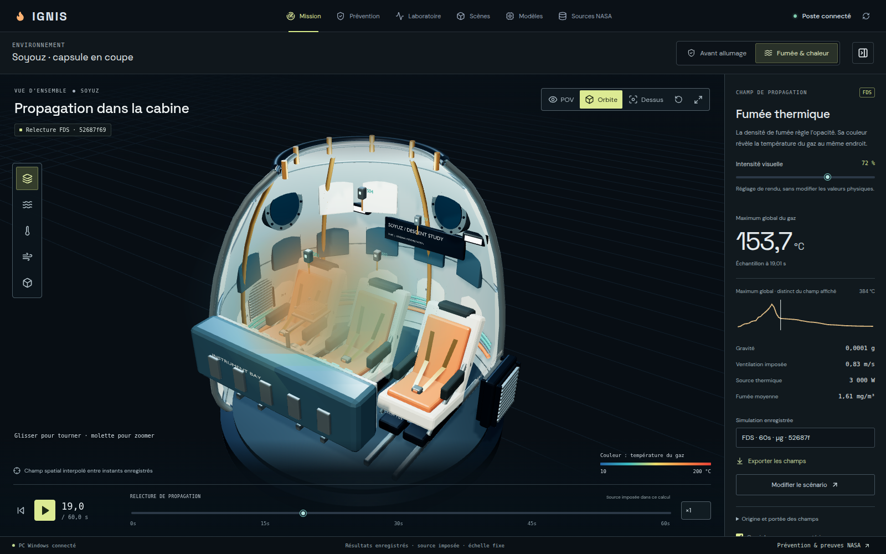
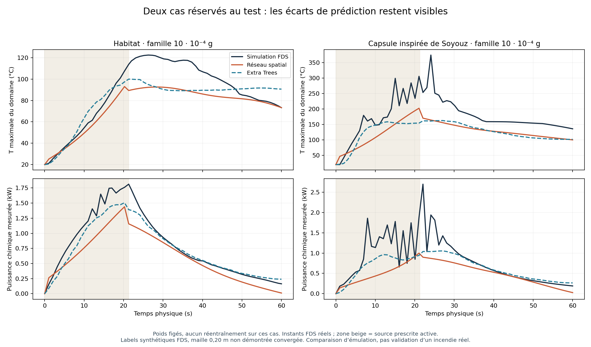

# IGNIS 3D — laboratoire et API

Le projet consolidé est décrit dans le [README principal](../README.md). Le site
immersif est à la racine et ce laboratoire React dans `web/` ; ils partagent le
modèle ventilation livré le 15 novembre et ses 216 scénarios vérifiés.

Application de recherche pour le challenge NASA **Flame in Freefall** : explorer
des scènes 3D, comparer gravité terrestre et microgravité, générer des simulations
reproductibles et consulter les observations expérimentales NASA pertinentes.

Le parcours de développement est maintenant **Prédiction IA → Simulation par
point sensible** : modèle 3D annoté, matériaux, ventilation et incident électrique
localisé. Le risque affiché décrit les conséquences conditionnelles du départ.
L’interface et les calculs utilisent le PC Windows ; le VPS conserve le code et
les preuves légères. Aucun appel à Ollama.

## Ouvrir l’application

- **Développement actuel** : <https://desktop-m4hkr86.tail609f26.ts.net:8444>
  (sur le PC : <http://127.0.0.1:8766>).
- Version précédente conservée : <https://desktop-m4hkr86.tail609f26.ts.net:8443>.
- Le PC doit être allumé, connecté à Tailscale et le service démarré.

Après un redémarrage de Windows, lancer dans PowerShell :

```powershell
powershell.exe -NoProfile -ExecutionPolicy Bypass -File E:/IGNIS-Valley-dev/app/tools/windows/start-ignis.ps1 -Root E:/IGNIS-Valley-dev/app -Runtime E:/IGNIS-Valley-dev/runtime -Port 8766
```

Le [guide Windows](WINDOWS.md) décrit l’arrêt, les fichiers, la reconstruction,
les commandes d’entraînement et les vérifications. Il n’y a pas de lancement
automatique à l’ouverture de session.

## POC courant

La vue `#iss` affiche les prédictions enregistrées de chaleur/fumée du U-Net 3D
de 379 046 paramètres. Elle compare le réseau et FDS et permet de changer la
ventilation au sein d'une même disposition. Le modèle et les 216 cas sont
désormais fournis dans le dépôt. `npm run dev` ou `npm run build`, depuis `web/`,
restaure et vérifie ces cas automatiquement. Les API de calcul ne sont pas
requises pour ce parcours de relecture.

Le [rapport courant](ISS_POC_VENT_MODEL.md) décrit les résultats et limites.
La campagne historique de 20 000 calculs reste en pause ; les anciens réseaux
ci-dessous sont conservés à titre d'historique et ne sont pas le modèle livré.

## Parcours de recherche précédent

- Deux pages centrées sur la scène 3D, avec POV, fumée et chaleur animées.
- 17 points électriques annotés dans quatre scènes, dont Soyouz.
- Cinq familles de départ, sources localisées et combustibles voisins réactifs.
- Un modèle Extra Trees apprend les champs température/suie du pilote FDS, avec
  évaluation séparée par disposition. Les domaines et inconnus restent visibles.
- Un U-Net 3D de 834 486 paramètres a réellement été entraîné sur la RTX 4070 Ti
  avec les 60 calculs pilotes. Ses résultats restent mitigés ; ce prototype
  est conservé séparément et n'est pas activé dans l'interface.
- La campagne historique visait 1 000 géométries procédurales distinctes et
  20 000 calculs FDS ; elle est en pause et n'est pas présentée comme achevée.
- Le bouton **Simuler ce départ** transmet le point et les mêmes conditions à FDS.
- Les observations NASA restent accessibles directement ; les anciens écrans
  sont regroupés dans **Outils**.

Voir [le fonctionnement et les limites](INCIDENTS.md),
[les profils physiques](INCIDENT_PHYSICS.md) et
[la campagne de scénarios](SPATIAL_CORPUS.md), ainsi que
[le réseau 3D et ses résultats GPU](SPATIAL_MODEL.md).

## Socle réutilisé et version précédente

- **Vue mission immersive** : accueil dans la cabine Soyouz en POV équipage,
  fumée volumétrique colorée par température, lecture temporelle, caméras orbitale
  et de dessus. Champs de simulations enregistrées, légende fixe et réglage
  d'opacité. Le mode avant allumage conserve les prévisions sur composants.
- **Prévention avant allumage** : scène sans foyer, composants
  sélectionnables, délai conditionnel appris sur une expérience de fil NiCr/LDPE,
  historique thermique et prévision ML distincts, comparaison et export.
  Les inconnus restent gris ; aucune probabilité de feu n'est fabriquée.
- **22 conclusions NASA classées** issues de 13 sources archivées, pages,
  conditions et limites visibles ; étude complémentaire Guo identifiée séparément.
  Codex explique à partir des preuves figées de l'analyse.
- **Quatre scènes Blender détaillées** : habitat, cargo, ventilation transversale
  et capsule inspirée de Soyouz. Fichiers `.blend`, GLB, proxies physiques,
  matériaux, bouches et capteurs ; [import d’un modèle annoté](SCENES.md).
- **FDS 6.11.1 exécuté sur CPU** : transport depuis une source prescrite,
  échauffement et pyrolyse couplés, source thermique ou chauffage électrique
  résistif I²R. Gravité, ventilation, oxygène, matériau et source sont réglables.
- **Visualisation interactive** : objets sélectionnables, champs échantillonnés
  de température, oxygène, suies et vitesse, chronologie, courbes et comparaison.
- **Campagnes de 2 à 100 scénarios** : graine, plages de paramètres, file persistante,
  annulation, provenance et exports JSON/CSV/Parquet.
- **Deux modèles de transport préchargés** : réseau spatial PyTorch et référence Extra Trees.
  Les poids et les scènes sont contrôlés par empreinte ; les requêtes hors domaine
  sont refusées. Entraînement CUDA réalisé sur RTX 4070 Ti.
- **Observations NASA traçables** : tables BASS-II, BASS et Saffire-I archivées,
  classement selon des critères visibles et interprétation par **Codex** avec
  citations. IGNIS n’appelle pas Ollama.



La [documentation de la vue mission](MISSION_VIEW.md) décrit navigation,
lecture, unités, provenance et limites du rendu.

## Résultats des modèles précédents

Prévention : 26 points expérimentaux d'allumage extraits d'une publication
complémentaire (pas des labels NASA), et 384 trajectoires électrothermiques
générées sur Windows. Le délai atteint une MAE de **0,157 s** sur 9 observations
réservées (5 courants). La température future atteint une MAE de **10,05 °C**
sur 1 940 fenêtres disponibles de 16 familles réservées ; erreur maximale
**129,30 °C**. Ces fenêtres ne sont pas des essais indépendants.
Voir [prévention et limites](PREIGNITION.md) et
[protocole ML](PREVENTION_MODELS.md).

Le pilote comprend **96 simulations FDS et 5 800 instants**, répartis en
48 calculs d’entraînement, 12 de validation et 36 de test. Les familles complètes
restent dans une seule partition ; la géométrie crossflow est réservée au test.
Les données et les poids sont conservés sur Windows, hors Git.

| Mesure sur les 36 calculs de test | Réseau spatial | Extra Trees |
|---|---:|---:|
| Erreur absolue moyenne de température maximale | 8,06 °C | 6,65 °C |
| Erreur absolue moyenne du pic par calcul | 26,53 °C | 21,37 °C |
| Erreur absolue moyenne de puissance chimique | 150,55 W | 81,71 W |

Les [résultats complets](MODELS.md) publient aussi les erreurs locales,
par scène et par gravité. Les pics Soyouz en microgravité sont mal reproduits.
Le réseau peut donner une température moyenne ou locale supérieure à son maximum
global prédit : il sert à la prévisualisation exploratoire.



## Portée scientifique

Les deux modèles de transport apprennent à reproduire **les simulations FDS**, avec un maillage
de 0,20 m dont la convergence n’est pas démontrée. Ils ne sont pas entraînés sur
des champs de flamme NASA. Les tables NASA importées et la calibration du
ventilateur BASS-II apportent des références documentaires et instrumentales ;
elles ne valident pas la combustion simulée.

La prédiction de transport couvre seulement une source prescrite,
à 10⁻⁴ g ou 1 g, dans les quatre géométries et plages publiées. Le solveur propose
en plus un mode couplé expérimental. Les matériaux sont génériques ; les arcs
électriques, le plasma, l’emballement de batteries et les systèmes de ventilation
fermés d’une capsule réelle restent hors périmètre. Soyouz est une interprétation
originale, avec une enveloppe physique simplifiée.

Le modèle de délai couvre le protocole restreint de fils de laboratoire sous
courant constant en microgravité. Il n'est pas validé sur le câblage d'une
capsule réelle. Les historiques de température sont simulés et leur modèle
local n'inclut pas l'allumage gazeux. Sans cas sans allumage, fréquence de panne
et validation indépendante, ni probabilité calibrée ni taux de fausses alertes
ne peuvent être annoncés. La position 3D ne couple pas encore le fil à un champ
CFD : l'air local est une hypothèse prescrite.

## Développement et preuves

Python 3.11, FastAPI, React, TypeScript strict et Three.js. Dépendances Python
épinglées, lockfile npm, contrats JSON, tests, CI et revue indépendante.
Le [contrat API](CONTRACTS.md) complète le schéma interactif `/docs` du service.

```bash
python -m pip install -e '.[test]'
ruff check backend tools tests
pytest -q
python tools/blender/validate_assets.py --require-all-artifacts
cd web
npm ci
npm test
npm run format:check
npm run build
```

La CI contrôle le code et les assets ; les essais réels FDS, CUDA et Windows
ont leurs propres preuves archivées :

- [Physique et vérifications FDS](PHYSICS.md)
- [Sources NASA, qualité des données et calibration](NASA.md)
- [Entraînement, domaines et audit des modèles](MODELS.md)
- [Vérification réelle de l’application](../evidence/application-verification.json)
- [Preuves de tests et captures navigateur](../evidence/README.md)
- [Vérification Blender et import/export](../evidence/blender-verification.json)
- [Plan et critères de livraison](../PLAN.md), [état de reprise](../REPRISE.md)

Challenge : <https://www.spaceappschallenge.org/2026/challenges/flame-in-freefall/?tab=details>.
