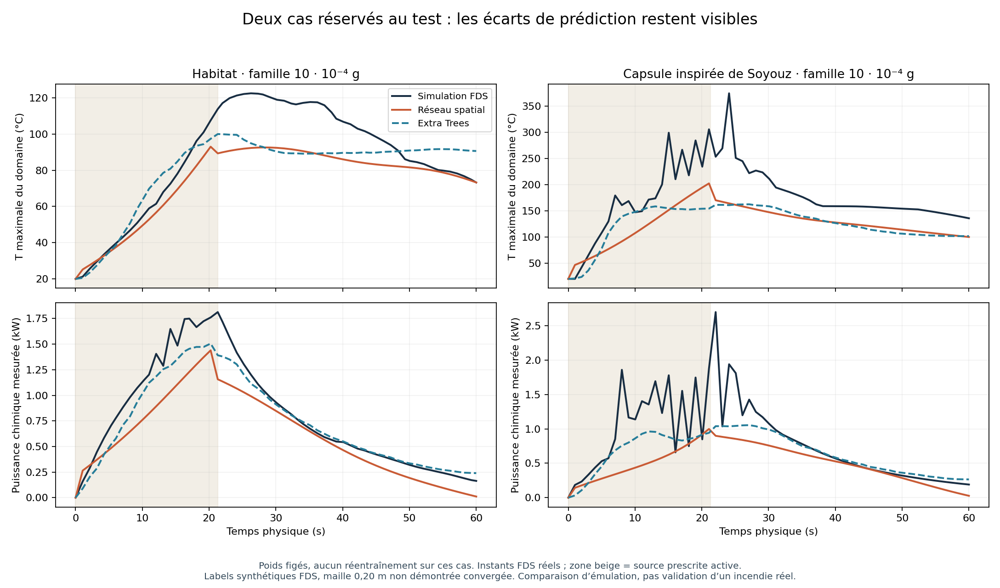

# Modèles prédictifs — pilote FDS v2

Deux modèles ont été entraînés sur le PC Windows à partir de **96 simulations
FDS terminées**, puis audités avec leurs poids figés. Extra Trees obtient les
plus petites erreurs de température maximale et de puissance chimique sur le
test. Le réseau fournit aussi des champs spatiaux, avec des erreurs locales et
des incohérences physiques qui interdisent de présenter sa sortie comme un
calcul CFD ou une estimation de sécurité validée.

L'audit du **14 novembre 2026** confirme l'intégrité des données et la
reproductibilité des évaluations. Il ne valide pas la physique de FDS dans une
cabine réelle. Aucune donnée expérimentale NASA de combustion n'a servi à
entraîner ou à valider ces deux modèles. Le traitement séparé des données
instrumentales BASS-II est décrit dans [NASA.md](NASA.md).

## Données et séparation des scénarios

Les labels viennent de FDS **6.11.1**, compilateur `ignis-fds-2`, matériaux
`ignis-fds-materials-2`, maille cible **0,20 m**. Le jeu `pilot-v2` contient
4 géométries × 12 familles de paramètres × 2 régimes de gravité, soit
**5 800 instants de mesure**. Chaque calcul simule 60 secondes physiques.
Les instants FDS réels sont conservés ; leur nombre peut varier légèrement.

| Partition | Calculs complets | Familles scène/paramètres | Instants |
|---|---:|---:|---:|
| Entraînement | 48 | 24 | 2 881 |
| Validation | 12 | 6 | 732 |
| Test | 36 | 18 | 2 187 |

Les deux gravités d'une même famille et d'une même scène restent ensemble.
Les familles de paramètres 0 et 5 des scènes habitat, cargo et Soyuz sont
réservées à la validation ; les familles 10 et 11 sont réservées au test.
Les huit autres familles servent à l'entraînement. Cela représente seulement
**huit combinaisons distinctes de paramètres continus** à l'entraînement,
répétées dans trois géométries et deux régimes de gravité.

La scène `crossflow` entière est réservée au test : ses 24 calculs évaluent le
transfert vers cette géométrie, avec des paramètres dont une partie est déjà
connue dans d'autres scènes. Les 12 autres calculs de test évaluent les familles
10/11 dans les géométries connues. Cette séparation empêche de répartir les
images d'un même calcul entre entraînement et test ; elle ne rend pas les
2 187 instants de test statistiquement indépendants.

## Ce que prédisent les modèles

| Modèle | Architecture | Sorties disponibles |
|---|---|---|
| `field-mlp-v2` | Réseau conditionnel dense 369 → 256 → 256 → 384 → 1 925, activations SiLU, 1 000 325 paramètres | 6 valeurs par point sur une grille d'observation 8 × 10 × 4, plus 5 métriques globales |
| `metrics-forest-v2` | ExtraTreesRegressor, 160 arbres, minimum de 3 observations par feuille, `max_features=0.85` | 5 métriques globales, aucun champ spatial |

Les entrées comprennent le temps, la gravité, la ventilation, l'oxygène, la
puissance et la durée de la source, le matériau, les dimensions, la position
de source, les bouches et le masque des points solides. Le réseau n'ingère pas
un maillage 3D quelconque. L'identité physique des quatre scènes est vérifiée
avant une prédiction ; modifier leur géométrie impose un nouveau jeu de données.

Les six valeurs spatiales sont température, fraction volumique d'O₂,
concentration de suies et trois composantes de vitesse. Les métriques globales
sont température maximale, température moyenne, O₂ moyen, suies moyennes et
puissance chimique effectivement libérée. **Les 320 points sont des observations
clairsemées, pas les cellules du solveur.** Les points solides restent `null`.
Les sondes de l'interface utilisent le point d'observation gazeux prédit le plus
proche ; elles ne constituent pas une nouvelle résolution spatiale.

Le réseau utilise des cibles transformées par `asinh`, une perte quadratique
masquée et pondérée, AdamW et un arrêt anticipé choisi sur la validation.
L'époque retenue est **102**. Les valeurs initiales connues de température et
de composition sont appliquées à t=0 ; les vitesses restent prédites. Les sorties
sont bornées par canal, sans contrainte reliant moyenne, maximum et champ.
La graine turbulente FDS n'est pas une entrée : les fluctuations individuelles
ne sont pas conditionnées à la graine d'un calcul.

L'entraînement enregistré a duré environ **7,38 s** pour le réseau sur une
RTX 4070 Ti, et **1,26 s** pour Extra Trees sur CPU. Le maximum de mémoire CUDA
allouée rapporté par PyTorch est de **157 MiB**, sans compter le contexte du
pilote ni les autres applications. Ces durées excluent la génération des
96 simulations FDS et ne mesurent pas le coût de construction du dataset.

## Domaine accepté et domaine réellement observé

| Paramètre | Enveloppe du plan | Minimum–maximum dans l'entraînement uniquement |
|---|---:|---:|
| Vitesse aux entrées, m/s | 0,05–0,40 | 0,09531–0,31699 |
| O₂, % vol. | 18–24 | 18,92247–23,58872 |
| Puissance chimique nominale, W | 500–3 000 | 500–2 880,14 |
| Durée de source, s | 8–25 | 9,31633–22,45478 |

Seuls **10⁻⁴ g et 1 g** sont acceptés, avec la maille de référence 0,20 m,
les matériaux génériques cellulose ou PMMA et le mode `prescribed_source`.
Les valeurs hors de ces limites sont refusées. Une valeur dans l'enveloppe
planifiée mais hors des minima/maxima observés à l'entraînement reçoit un
avertissement. Être à l'intérieur des minima/maxima ne garantit pas une
couverture suffisante des combinaisons de paramètres.

Le domaine publié du modèle annonce une observation entre 2 et 60 s, mais impose aussi
`durée de source ≤ durée d'observation`. Avec la source minimale de 8 s, la
durée minimale effectivement admissible pour ces modèles est donc 8 s. Le
dataset de référence observe toujours 60 s ; demander moins tronque l'horizon
de prédiction. Aucun résultat au-delà de 60 s n'est proposé.

Le mode étudié transporte les produits d'une **source chimique prescrite**.
Ces modèles ne prédisent ni l'allumage électrique, ni une propagation couplée
aux matériaux, ni l'extinction laminaire d'une flamme en microgravité. Ces
distinctions et les conditions de ventilation sont détaillées dans
[PHYSICS.md](PHYSICS.md).

## Erreurs sur le test indépendant de l'entraînement

Les valeurs ci-dessous ont été recalculées sur Windows à partir des **CSV FDS
originaux**, sans encoder ou écrêter les vérités terrain. Les poids sont ceux
de l'entraînement initial. MAE signifie moyenne des erreurs absolues ; P95
est le 95e percentile des erreurs, pas une borne de confiance.

| Indicateur, 36 calculs de test | Réseau spatial | Extra Trees |
|---|---:|---:|
| MAE température maximale globale | 8,06 °C | 6,65 °C |
| P95 erreur température maximale globale | 33,40 °C | 28,42 °C |
| MAE du pic temporel de température, un poids par calcul | 26,53 °C | 21,37 °C |
| MAE puissance chimique libérée | 150,55 W | 81,71 W |
| MAE température moyenne | 0,0501 °C | 0,0546 °C |
| MAE O₂ moyen | 0,000652 point de % | 0,000618 point de % |
| MAE suies moyennes | 5,83 × 10⁻⁸ kg/m³ | 6,25 × 10⁻⁸ kg/m³ |

Les métriques temporelles agrégées pondèrent chaque instant également. Les
erreurs de pic pondèrent chaque calcul également. Les fichiers d'évaluation
fournissent aussi les MAE temporelles avec un poids égal par calcul.

Pour le champ du réseau, la MAE de température est **0,191 °C**, et **2,413 °C**
sur les seuls points chauffés au-delà de l'ambiante + 2 °C (9 196 observations,
P95 **7,116 °C**). La référence constante à 20 °C du rapport d'entraînement
donne respectivement **0,202 °C** et **5,759 °C**. Les nombreuses observations
proches de l'ambiante expliquent la petite erreur globale ; elles ne démontrent
pas une bonne reconstruction de la zone la plus chaude.

Les MAE de vitesse U/V/W du réseau sont **0,0143 / 0,0225 / 0,0126 m/s**.
Pour V, la référence constante à vitesse nulle fait mieux : **0,0182 m/s**.
Le réseau n'améliore donc pas tous les canaux par rapport à une référence
élémentaire. Le pic des 320 observations spatiales est distinct du maximum
global de FDS, qui peut se trouver entre ces points.

| Sous-ensemble de test | Calculs | MAE Tmax réseau / arbres | MAE pic par calcul réseau / arbres |
|---|---:|---:|---:|
| Géométrie crossflow réservée | 24 | 6,61 / 4,81 °C | 18,07 / 12,52 °C |
| Familles 10/11, géométries connues | 12 | 10,94 / 10,30 °C | 43,46 / 39,07 °C |
| Soyuz, 10⁻⁴ g | 2 | 32,58 / 30,31 °C | 95,69 / 123,35 °C |

Deux calculs ne suffisent pas à estimer une performance générale sur Soyuz en
microgravité. Le calcul `soyuz-f10-microg` atteint **373,98 °C** dans FDS,
contre **202,13 °C** pour le réseau et **162,34 °C** pour Extra Trees. Aucune
correction n'a été ajustée à partir de ce cas réservé au test.



Les deux identifiants représentés, `habitat-f10-microg` et `soyuz-f10-microg`,
ont été fixés avant l'audit. Les modèles sont évalués aux instants FDS originaux,
sans interpolation des labels. La zone beige indique la durée de la source.

## Incohérences physiques observées

Les sorties du réseau sont indépendantes entre elles. L'audit recherche les
contradictions avec une tolérance numérique de 0,01 °C :

| Relation violée, sur 2 187 instants de test | Réseau | Écart maximal | Extra Trees |
|---|---:|---:|---:|
| Température moyenne supérieure au maximum global prédit | 307 instants | 10,78 °C | 0 |
| Un point spatial supérieur au maximum global prédit | 443 instants | 11,48 °C | Sans champ spatial |

Ces ensembles peuvent se recouvrir. Ils montrent que le réseau ne produit pas
un champ globalement cohérent, même lorsque son erreur moyenne paraît petite.
L'absence de ces contradictions chez Extra Trees ne constitue pas une preuve
de conservation de masse ou d'énergie. L'audit conserve les sorties originales
et les erreurs ; aucun post-traitement choisi après consultation du test ne
masque les incohérences.

Pour l'affichage, les objets `metrics.validation.consistency` et
`metrics.test.consistency` des métadonnées sont des copies exactes du rapport
audité. `consistency_tolerance_c=0.01` explicite le seuil, et le champ `frames`
de chaque partition fournit le dénominateur. Cet ajout descriptif ne relance
aucune évaluation ; son origine et les nouvelles empreintes des métadonnées
sont consignées dans `model-audit-metadata.json`.

## Temps de prédiction mesuré

Mesures sur le CPU du PC Windows, un processus, modèle déjà chargé : première
mesure puis médiane de trois répétitions, pour 61 instants de 0 à 60 s.

| Scène | Réseau, médiane | Extra Trees, médiane |
|---|---:|---:|
| Habitat | 65,5 ms | 35,9 ms |
| Cargo | 65,1 ms | 37,1 ms |
| Crossflow | 65,0 ms | 35,8 ms |
| Soyuz | 60,6 ms | 34,4 ms |

Cela inclut la compilation de la géométrie d'observation, les prédictions et
la construction des résultats. Le chargement des poids, la sérialisation HTTP,
le transfert réseau et l'affichage ne sont pas inclus. La première mesure de
chaque scène intervient après les évaluations précédentes : `cold_call_s`
dans le JSON désigne seulement sa première répétition chronométrée, pas un
démarrage à froid du système. Ce n'est pas un test de charge concurrente.

## Intégrité et identité des scènes

L'audit a contrôlé les 96 combinaisons uniques, les partitions, les versions,
les empreintes de résultats et d'entrées, les horodatages, les masques, les
positions d'observation et la relecture exacte des CSV FDS. Il a aussi recompilé
les scènes enregistrées et les scènes actuelles avec chaque configuration :
**les 96 fichiers FDS et leurs plans d'échantillonnage sont identiques**.

Les quatre parois de habitat, cargo et crossflow avaient seulement changé de
représentation JSON : coordonnée Y `4` → `4.0`, dimension Y `8` → `8.0`, soit
24 différences de type au total. L'identité physique version 2 normalise
uniquement les flottants entiers vers des entiers. Elle conserve les valeurs
non entières, les booléens et tous les paramètres physiques. `canonical_sha`,
utilisé pour la provenance du calcul, reste inchangé.

Les anciens hashes, les différences exactes et les 96 preuves de compilation
sont archivés. Les métadonnées ont été migrées **après réussite de l'audit
complet** ; les poids n'ont pas changé. Les minima/maxima observés ajoutés aux
métadonnées utilisent exclusivement les 48 calculs d'entraînement.

| Artefact | SHA-256 |
|---|---|
| Réseau, `weights.pt` | `38d81a6220c87e0cfe72404308fc710b5916c6ebeb44143d3640f4ab15bc2f6c` |
| Extra Trees, `weights.joblib` | `ff0ea10dd651854499fb9db5a993f0ebecb06d4ea0d884423a37e3913206be69` |
| Audit | `227d75d59a034364afc98dc9c3f1ba229357735bb18d0edd3b5f21c7ec2a145b` |
| Preuve d'identité des scènes | `46537d64694df4dd52b1abf08ae6a27e26c136fb95cbf40c970f394573100095` |

## Artefacts et reproduction

- [model-audit.json](../evidence/model-audit.json) : contrôles de chaque calcul,
  domaine, système, latences et empreintes.
- [model-metrics.json](../evidence/model-metrics.json) : erreurs par partition,
  scène, gravité et calcul ; incohérences physiques.
- [model-comparison.json](../evidence/model-comparison.json) : données exactes
  des courbes FDS et modèles.
- [model-scene-identity.json](../evidence/model-scene-identity.json) : migration
  d'identité numérique et preuves des 96 recompilations.
- [model-audit-metadata.json](../evidence/model-audit-metadata.json) : empreintes
  des métadonnées finales et des poids inchangés.
- [Métadonnées réseau](../evidence/models/field-mlp-v2/metadata.json),
  [métadonnées Extra Trees](../evidence/models/metrics-forest-v2/metadata.json)
  et [historique réseau](../evidence/models/field-mlp-v2/training-history.json).

Sur le **PC Windows**, après installation des dépendances du projet :

```powershell
$env:IGNIS_HOME = 'E:/IGNIS-Valley'
$env:PYTHONPATH = 'E:/IGNIS-Valley/app/backend'
& 'E:/IGNIS-Valley/.venv/Scripts/python.exe' `
  'E:/IGNIS-Valley/app/tools/remote/audit_models.py'
```

L'audit prend les verrous dataset et calcul, ne lance pas FDS et ne réentraîne
rien. Il écrit ses rapports dans `runtime/model-audit` et actualise les
annotations de métadonnées après réussite. Le premier historique de migration
reste conservé. Les nouvelles dates et mesures de temps changent naturellement
l'empreinte d'un rapport répété.

Le graphique seul peut être reproduit sans inférence à partir des JSON :

```text
python tools/remote/audit_models.py --plot-input evidence/model-comparison.json --plot-output evidence/model-comparison.png
```

Le rendu publié utilise Matplotlib 3.10.7. Toutes les inférences, l'entraînement
et la lecture des labels FDS pour l'audit ont eu lieu sur Windows ; le graphe et
la vérification des fichiers transférés sont des traitements légers.

## Étape scientifique suivante

La maille FDS de référence n'est pas démontrée convergée. Les erreurs ci-dessus
mesurent l'émulation de ces calculs exploratoires. Pour améliorer le système,
il faut d'abord définir une sortie physiquement cohérente, augmenter la diversité
des scénarios, réserver de nouvelles familles de test avant les modifications,
puis évaluer les pics et les zones chauffées séparément de l'ambiante. Une
validation contre des expériences NASA comparables, avec leurs incertitudes,
reste nécessaire avant toute revendication de prédiction d'incendie réel.
