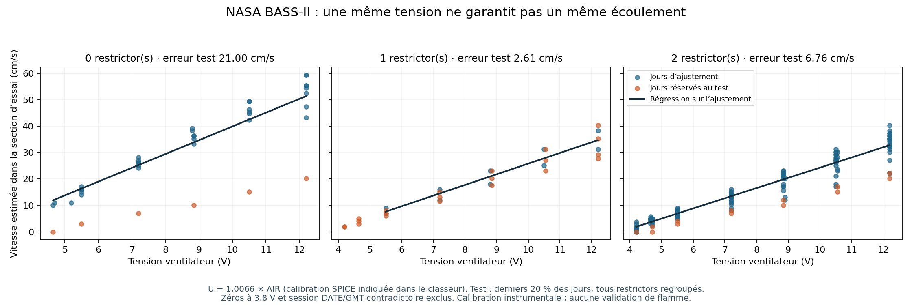

# Ressources NASA effectivement exploitées

Les résultats NASA restent distincts des sorties FDS et des prédictions de leurs
substituts. Le premier traitement quantitatif porte sur la **calibration du
ventilateur BASS-II**, pas sur une calibration de la combustion ou de FDS.

## Source et traçabilité

- Investigation : [NASA PSI-25 — BASS-II](https://psi.nasa.gov/physci/repo/data/investigations/PSI-25),
  DOI **10.60555/4qc4-de67**.
- Classeur : `PSI-25_Reference Data_Fan calibration data.xlsx`, version 2,
  mise à jour PSI du 24 novembre 2025, 23 973 octets.
- Identifiant de fichier PSI : `692480587f6aa6a830210600`.
- Copie locale : `data/sources/BASS-II-fan-calibration.xlsx` ; métadonnées source
  dans le fichier `.provenance.json` adjacent.
- Inventaire des essais : `data/sources/PSI-25.csv`, 129 lignes d'essais.

`tools/nasa/calibrate_fan.py` lit les cellules XML locales du classeur. Aucune
formule, macro ou référence externe n'est exécutée. Les empreintes SHA-256 du
classeur et du CSV, les références de cellules et les identifiants des points
sont conservés dans les sorties. Le code refuse une modification des cellules
documentant les conversions au lieu de réutiliser silencieusement les unités.

## Ce que mesure cette calibration

L'onglet `Fan Calibration data` donne explicitement :

- cellule D7 : **tension ventilateur = Fan Display / 10**, en volts ;
- cellule A33 : **U = 1,0066 × AIR**, en cm/s ;
- cellule A34 : conversion issue de SPICE, à **56 mm en aval et 36 mm du bas**,
  sur l'axe de la section d'essai.

Le coefficient convertit un affichage AIR en une **estimation locale de vitesse**.
Il ne mesure ni une vitesse moyenne de cabine ni le débit d'une bouche IGNIS.
Son incertitude et celle de l'instrument ne sont pas fournies dans le classeur ;
les champs d'incertitude restent `null`, jamais zéro.

Le classeur précise que le ventilateur s'arrête à une tension supérieure à
3,8 V et recommande de ne pas utiliser ses points zéro à 3,8 V. Les autres
zéros effectivement observés, à une tension différente, sont conservés.

## Extraction et contrôle de qualité

| Élément | Nombre |
|---|---:|
| Sessions de calibration | 27 |
| Paires Fan/AIR renseignées | 262 |
| Emplacements avec une valeur Fan ou Pot mais sans paire Fan/AIR complète | 298 |
| Paires admissibles | 211 |
| Paires réservées à l'ajustement | 171 |
| Paires réservées au test | 40 |

Les trois groupes de réducteurs de débit (`restrictors`) sont lus par leurs
en-têtes, car les numéros de lignes changent selon les sessions. Les absences
restent absentes ; aucune valeur AIR n'est interpolée pour compléter le tableau.

La première session est incohérente : B3 indique le 1er avril 2014, alors que
B4 indique `2014-043`, soit le 12 février 2014. Ses **18 paires sont archivées
mais exclues de l'ajustement et du test**. Parmi les autres sessions, 33 paires à
3,8 V sont également exclues selon la note NASA. Cette classification évite le
double comptage des points 3,8 V déjà présents dans la session incohérente.

Les métadonnées des sessions mentionnent nettoyages de suie, réparation de porte
et relevés avant/après opérations. La réponse change fortement : à 12,2 V sans
réducteur, AIR vaut 59 le 18 février et 20 le 29 juillet. Une tension seule ne
suffit donc pas à reconstruire l'écoulement de toutes les sessions.

## Ajustement séparé du test

Une régression linéaire simple est ajustée par nombre de réducteurs. Chaque
journée contribue avec un poids total égal, pour que les sessions comportant
plus de points ne dominent pas l'ajustement. Les sorties négatives sont ramenées
à zéro. Aucune prédiction n'est produite hors de la plage de tension observée
pendant l'ajustement.

La séparation est chronologique et déterministe : derniers `ceil(20 %)` des
jours admissibles réservés au test. Toutes les sessions et tous les réducteurs
d'une même journée restent ensemble. L'ajustement couvre **19 jours**, du
14 février au 22 juillet 2014. Les **5 jours de test** sont les 28, 29 et
31 juillet, puis les 1er et 4 août. Aucun paramètre n'est réajusté sur le test.

| Réducteurs | Points / jours d'ajustement | Domaine, V | Test évalué / total | Jours de test présents | MAE, cm/s | RMSE, cm/s | MAE référence constante, cm/s |
|---|---:|---|---:|---:|---:|---:|---:|
| 0 | 35 / 8 | 4,65–12,20 | 6 / 6 | 1 | 21,00 | 22,17 | 25,83 |
| 1 | 10 / 2 | 5,50–12,20 | 16 / 21 | 3 | 2,61 | 3,33 | 8,65 |
| 2 | 126 / 19 | 4,20–12,20 | 13 / 13 | 2 | 6,76 | 7,65 | 8,85 |

La référence constante est la moyenne pondérée des vitesses d'ajustement. Les
erreurs sont calculées sur les points de test dans le domaine ; cinq points du
groupe à un réducteur sont explicitement hors domaine. Les points d'une journée
sont corrélés : 40 points ne représentent pas 40 essais indépendants. Le groupe
à un réducteur n'a que deux jours d'ajustement ; sa plus petite erreur ne lui
confère pas une validité générale.



**Résultat exploitable :** la régression permet d'évaluer la stabilité de la
calibration et d'exposer ses erreurs. Elle ne justifie pas une conversion
universelle tension → vitesse. Pour une session identifiée, la fonction
`local_conversion` interpole uniquement entre ses propres points admissibles,
avec références des deux cellules d'ancrage et refus de toute extrapolation.
Cette interpolation n'a pas de score de test indépendant et reste étiquetée
comme interpolation instrumentale.

## Conversion prudente de l'inventaire des combustions

`evidence/nasa-bass2-airflow.json` conserve une ligne par essai original :

| État de l'affichage AIR | Essais | Traitement |
|---|---:|---|
| Une valeur numérique strictement positive | 24 | Conversion `AIR × 1,0066 / 100` en m/s |
| Plusieurs valeurs, consignes ou annotations | 100 | Texte conservé ; segmentation manuelle nécessaire |
| Zéro affiché | 1 | Valeur brute conservée ; vitesse exacte non inférée |
| Absence | 4 | Aucune vitesse fabriquée |

Par exemple, l'essai B1 affiche AIR=5, soit **0,05033 m/s estimé au point de
référence**. L'essai B6 affiche `3   5   approaching 10` : il reste une séquence,
sans moyenne artificielle. Ces vitesses viennent de l'affichage AIR et du
coefficient documenté, **pas de la régression tension → vitesse**.

Ces 24 valeurs ne constituent pas un jeu de labels de feu complet. L'alignement
avec température, échantillon, atmosphère, régime de ventilation et chronologie
de chaque combustion doit précéder une comparaison physique. Aucune de ces
vitesses n'est copiée automatiquement dans une bouche de cabine FDS.

## Artefacts et reproduction

```text
python tools/nasa/calibrate_fan.py
python tools/nasa/calibrate_fan.py --plot
PYTHONPATH=backend python -m unittest discover -s tests/physics -v
```

L'extraction et l'ajustement utilisent seulement Python standard. Le graphe
optionnel a été produit avec Matplotlib 3.10.7.

- `evidence/nasa-fan-calibration.json` : source, cellules, exclusions, partitions,
  coefficients, prédictions et erreurs pour chaque point réservé au test.
- `evidence/nasa-bass2-airflow.json` : 129 lignes et conversion des 24 scalaires.
- `evidence/nasa-fan-calibration.png` : comparaison visuelle des jours
  d'ajustement et des jours réservés au test.
- `tests/physics/test_nasa_calibration.py` : contrôles d'unités sur cellules
  réelles, lignes de groupes variables, exclusion des ambiguïtés, séparation
  temporelle, refus d'extrapolation et préservation des séquences.

## Prochaine validation de combustion

Les ressources [BASS](https://psi.nasa.gov/physci/repo/data/investigations/PSI-26),
[Saffire-I](https://psi.nasa.gov/physci/repo/data/investigations/PSI-98), le
[rapport BASS-II](https://ntrs.nasa.gov/citations/20210011385) et l'étude
[Saffire V](https://ntrs.nasa.gov/citations/20240008602) donnent des contextes
complémentaires. Elles ne sont pas interchangeables : dimensions, matériaux,
écoulement et observables doivent correspondre à la question étudiée.

Pour valider un modèle de flamme, il faudra identifier des essais comparables,
extraire leurs mesures temporelles, documenter les incertitudes, réserver des
essais indépendants, puis mesurer l'écart simulation/expérience. La grille de
cabine actuelle et ses matériaux génériques ne résolvent pas une flamme
laminaire BASS-II. Le travail effectué ici apporte des données instrumentales
NASA vérifiables et un test explicite de leur transférabilité.
