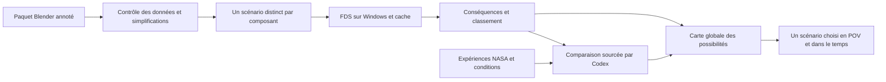

# IGNIS — proposition après vérification de l'existant

**Mise à jour du 14 novembre, 22:11 Paris :** Thomas fixe le rendu au 15 novembre
à 18 h et demande désormais un POC ML visuel, avec un entraînement simple
terminé ce soir. Le planning 4–7 jours décrit ci-dessous est donc écarté pour
ce rendu. L'audit factuel reste utile ; la priorité d'exécution est consignée
dans `REPRISE.md` et les documents `HOTSPOT_POC*`.

14 novembre 2026. Développement uniquement. Cette proposition remplace la
feuille de route de génération massive ; elle ne lance ni implémentation
produit, ni nouvelle campagne, ni entraînement.

**Décision recommandée : construire un explorateur 3D des conséquences d'un
incident par composant, fondé d'abord sur FDS et relié aux preuves NASA.**
Chaque composant électrique est un départ potentiel évalué séparément. Le
résultat répond à « si cela commence ici, qu'est-ce qui serait exposé ? ».
Il ne mesure pas la probabilité de panne ou d'incendie.

Je corrige l'ordre de priorité suivi : la quantité de simulations et la baisse
de l'erreur moyenne ont pris trop de place avant la démonstration du classement
des départs et des zones affectées. Le travail conservé fournit un socle utile,
mais ne démontre pas encore cette utilité ni une généralisation fiable.

**État vérifié et préservé.** À 20:49 UTC, aucun processus de génération,
FDS ou entraînement n'est actif. Les API précédente et développement répondent
`status=ok`. Le générateur initial est arrêté à 64 cas ; STOP et PAUSE sont
présents. Le lot prospectif de 100 nouveaux cas n'a jamais été lancé.

L'ablation `hot_peak` a été arrêtée à 20:41:36 UTC après confirmation de son
checkpoint 9 500. Faute de contrôle STOP dans ce runner, ses deux processus ont
été terminés : ce n'est pas une finalisation normale. Le checkpoint a été
rechargé strictement sur CPU, ses tenseurs sont finis et son SHA-256 concorde.
Aucun forward ni CUDA utilisé pour cette vérification. Données, poids, sources,
journaux et services conservés ; aucun nouveau modèle activé.

| Ensemble disponible sur Windows dev | État vérifié | Ce qu'il prouve |
|---|---|---|
| `incidents-v1` | 60 simulations terminées ; 30 train / 15 validation / 15 test | Pilote du parcours incidents, pas un corpus généraliste. |
| `spatial-corpus-v1` | 64 terminées sur 20 000 prévues ; arrêté | 20 000 était une cible, jamais un nombre produit. |
| `spatial-compact-200-v1` | 200 cas / 100 dispositions ; 120 train / 40 validation / 40 test | Deux gravités par disposition ; 192 nouveaux calculs et 8 réemplois. |
| `spatial-compact-v1` | Première version de 100 cas conservée | Recouverte par le compact final ; ne pas additionner les deux lots. |
| Modèles publiés dans le runtime | Extra Trees `incident-field-v1`, U-Net `spatial-pilot-v1` et `spatial-recovery-v1` | Seul l'ancien Extra Trees est branché à la carte incidents. |
| Nouveaux essais hors ligne | Fit `hot` complet ; `hot_peak` partiel sauvegardé | Artefacts de développement, aucun nouveau test indépendant ni déploiement. |

Les manifests ont été relus et empreintés ; ce contrôle ne prétend pas avoir
revalidé chaque gros fichier brut. Le dossier de lancement initial avorté
contient un échec, pas un scénario exploitable. Les modèles et données de
l'ancienne application sont également restés en place.

**Pourquoi le modèle ne doit pas décider de la carte actuelle.** Sur les
40 cas de validation, le fit `hot` complet retrouve 35,81 % des observations
chaudes, avec 28,66 % de précision, au seuil **ambiante + 5 °C**. Un pic FDS
échantillonné à 456,73 °C est prédit à 21,62 °C à sa vraie position et son vrai
instant. La fumée obtient 83,27 % de rappel et 55,26 % de précision au seuil
diagnostique de 0,1 mg/m³. Ces scores ne sont ni des probabilités ni les métriques
produit aux seuils actuels de 60 °C / 10 mg/m³.

Le checkpoint partiel `hot_peak` 9 500 a 45,49 % de rappel thermique pour
13,56 % de précision sur validation : davantage de détections, mais beaucoup
plus de fausses alertes. Pas de comparaison à budget égal avec les 20 000 pas
du fit complet. Aucun de ces résultats n'établit le classement des composants.

La supervision elle-même est insuffisante : seuls 0,242 % des points × instants
train sont chauds ; dans 32/120 cas, FDS contient un maximum global ≥25 °C mais
aucune sonde de la grille n'atteint 25 °C. Les archives n'ont pas de champ dense
caché à récupérer. Chaque disposition compacte n'évalue qu'un site et un type
de départ, dans deux gravités. Elle ne constitue donc pas une comparaison de
tous ses composants à conditions communes.

**Ce que nous pouvons réutiliser.** Le modèle Blender/GLB, les annotations,
le compilateur et le worker FDS, les exports, les mesures d'exposition, la POV,
les couches chaleur/fumée et la chronologie existent. Le backend parcourt déjà
tous les composants avec le modèle Extra Trees. Ce qui manque est un résultat
fiable et classé, une enveloppe des zones atteintes attribuable aux scénarios,
le surlignage des équipements exposés et un import intégré au produit.

| Import actuel | Conséquence pour le produit à construire |
|---|---|
| Export CLI de boîtes alignées sur les axes et annotations explicites ; pas d'import utilisateur dans l'interface | Fournir un paquet visuel + description physique contrôlé ; montrer les différences. Le mesh courbe de Soyouz n'est pas la frontière de calcul. |
| Matériaux associés par ID ; tables backend pour cellulose générique, PMMA et quatre inertes | Les textures ne donnent aucune propriété thermique. Conserver valeur, unité, source et domaine des propriétés ; refuser ou signaler toute substitution. |
| Objets `wall` ignorés ; enceinte aluminium 1 cm par défaut | Montrer cette hypothèse et bloquer une annotation contradictoire ; les cloisons doivent être des obstacles supportés. |
| `nominal_speed_m_s` par bouche exporté mais ignoré ; débit global réparti par aire | Le MVP explicite un seul débit équilibré. Les bouches indépendantes nécessitent un travail distinct, jamais un réglage silencieusement ignoré. |
| Composant placé sur une face supérieure ; faces latérales inertes | Limiter le premier import à ces placements ; pas de câblage arbitraire ou de surfaces réactives complètes. |
| Source thermique/émissions équivalentes pour arc, couvant et batterie | Pas de plasma, de projections, d'électrochimie ou de probabilité de défaut prédits. |
| API : 320 sondes, campagnes spatiales : 1 536 ; rendu lissé | Le rendu ne crée pas des mesures. Ajouter des observations près des sources, équipements et passages avant de qualifier ces zones. |

FDS peut résoudre un nouvel environnement sans apprentissage. Ses capacités
générales, documentées par le [NIST](https://pages.nist.gov/fds-smv/), dépassent
notre compilateur : ici, domaine cartésien, obstacles rectangulaires, pas de
réseau HVAC, matériaux génériques et réaction des faces supérieures seulement.
Une gravité faible dans FDS ne démontre pas la fidélité de sa chimie aux flammes
diffusantes, aux extinctions ou aux flammes froides de microgravité. La priorité
réaliste est le **transport de chaleur/fumée et l'exposition conditionnelle**.
L'inflammation d'un voisin exige une observation distincte de réaction du
matériau ; une température gazeuse proche ne suffit pas.

**Comparaison des architectures.** Les délais ci-dessous sont des estimations
pour des scènes simples ; les chiffres mesurés et leurs conditions suivent.

| Solution | Livraison et données nécessaires | Réponse, calcul | Environnements nouveaux, travail et limite |
|---|---|---|---|
| **FDS par composant + cache** | Champs temporels, conséquences et classement ; scène physique, matériaux, sources, bouches, ambiance et gravité. Aucun dataset d'apprentissage requis. | Premier passage : minutes sur CPU ; cache : cible <2 s. Le coût croît avec composants × profils × conditions. | Recalcule les géométries acceptées ; exige observations adéquates et contrôle de résolution. 2–4 jours pour la boucle produit seule, hors import et dossier NASA. |
| **Géométrie et physique simplifiée** | Graphe de proximité, obstacles, matériaux et chemins possibles d'écoulement ; indice explicable d'exposition. Pas de dataset requis pour le calcul initial, mais une référence nécessaire pour le tester. | Cible <2 s pour ≤10 sources sur CPU, non mesurée. | 2–5 jours pour l'indice et sa comparaison ; 5–10 avec transport dynamique à vérifier. Les bouches seules ne déterminent pas les recirculations. Ne fournit pas d'emblée une fumée physique ni une preuve de zone sûre. |
| **ML spatial hybride** | Approximation rapide des champs et/ou classement par source, avec référence FDS. Besoin de géométries et sources variées, observations adaptées et scènes réservées. | Inférence GPU potentiellement rapide ; temps complet d'une carte encore à mesurer. Génération FDS sur CPU en amont. | 4–8 jours pour intégrer et évaluer les poids existants ; délai de généralisation satisfaisante inconnu. Les erreurs actuelles imposent un statut expérimental. |

Ces alternatives ne s'additionnent pas. Je recommande la première pour la
preuve produit. Un indice simple sert de référence concurrente, sans construire
d'abord un deuxième simulateur complet. La version FDS ne promet pas une carte
physique instantanée d'une géométrie jamais calculée : elle fournit des résultats
progressifs, puis une exploration rapide du cache.

**Architecture recommandée et parcours concret.**

1. L'utilisateur importe le paquet exporté depuis Blender. L'interface montre
   les objets et composants reconnus, le matériau physique associé, les bouches
   retenues et les informations inconnues. Une propriété non supportée n'est
   pas acceptée silencieusement. Le `.blend` reste l'outil de préparation ;
   l'import produit utilise le GLB et le JSON, sans exécuter de script Blender.
2. Il choisit un profil d'incident, une puissance/durée et les conditions
   communes. Chaque composant reçoit **son propre calcul**. À profil et puissance
   communs, on compare les conséquences de chaque emplacement et de ses matériaux,
   sans attribuer leur différence à la seule position ; des puissances propres
   aux équipements ne sont utilisées qu'avec leurs justifications visibles.
3. La file affiche « 2/5 départs calculés ». Les autres restent inconnus. Le cache
   dépend de la scène physique, des matériaux, de la source, du profil, de la
   ventilation, de l'ambiance, de la gravité, du maillage, des observations,
   de l'horizon et des versions. Changer une entrée physique invalide le résultat.
4. La carte **Analyse** classe les départs selon les équipements critiques et
   passages exposés, puis le délai d'exposition et les autres équipements. Les
   critères sont visibles et triables ; données manquantes et ex æquo restent
   explicites. Pas de score arbitraire converti en « % de risque ».
5. Les couches globales montrent séparément le maximum de chaleur ou de fumée
   parmi les scénarios et instants étudiés. Chaque zone conserve le départ,
   le temps et les hypothèses qui expliquent sa valeur. Il n'y a ni addition
   des feux, ni animation de cette enveloppe comme une trajectoire réelle.
6. Cliquer une zone retrouve le scénario responsable. La vue **Simulation par
   point sensible** ouvre ce seul départ, avec POV, temps, équipements exposés
   et champs associés. Chaleur et fumée peuvent avoir des scénarios responsables
   différents dans l'enveloppe ; la sélection doit l'indiquer.
7. Modifier une disposition ou la ventilation crée une variante comparée à
   source et autres conditions identiques. Une recommandation suit les écarts
   réellement calculés. Une source NASA éclaire le mécanisme et ses limites ;
   elle n'est pas une certification de la zone affichée.

Les seuils d'exposition actuels, 60 °C et 10 mg/m³, restent des comparateurs
exploratoires configurés et visibles, pas des seuils d'allumage ou de survie.
Les valeurs non observées ne deviennent jamais « faibles » ou « sûres ».

**Place éventuelle du ML.** Ses entrées seraient la géométrie physique 3D,
les propriétés/épaisseurs, les bouches et débits prescrits, l'ambiance, O₂,
la gravité, ainsi que position, surface, puissance, durée et temps de la source.
Ses sorties seraient T/suie aux points et instants observés, puis le même
vecteur de conséquences ; une tête de classement serait une autre option à
tester, avec comparaisons entre composants d'une même scène. Le débit aux
bouches n'est pas un champ intérieur de vitesse connu.

La géométrie commune serait encodée une fois, puis chaque source interrogée
séparément ou par lot. On peut classer les sources d'abord et demander le champ
détaillé uniquement pour celle sélectionnée. Les cibles seraient des mesures
FDS correctement localisées, masquées lorsqu'elles manquent, complétées par
exposition et arrivée. Jamais un maximum global recopié sur des voxels.
L'activation nécessiterait un gain mesuré face à l'indice simple et au parcours
FDS, sur des scènes nouvelles. L'entraînement supervisé et les cas difficiles
sont adaptés à cette question ; le reinforcement learning n'apporte pas de
preuve supplémentaire à ce stade.

**Contribution explicite au challenge NASA.** L'application doit aussi
résumer, comparer et classer les connaissances expérimentales pertinentes.
Codex peut expliquer des faits et écarts de domaine structurés, en citant les
sources. Il ne fournit pas les propriétés physiques manquantes ; aucun Ollama.
Le classement des preuves (conditions comparables, mesures disponibles,
traçabilité, indépendance) reste distinct du classement des composants.

| Source accessible ou déjà archivée | Variables effectivement disponibles | Utilisation dans la démo et limite |
|---|---|---|
| [BASS-II, PSI-25](https://psi.nasa.gov/physci/repo/data/investigations/PSI-25) et [rapport NASA](https://ntrs.nasa.gov/citations/20210011385) | Inventaire de 129 essais : matériau/dimensions, AIR/Fan, O₂/CO₂/CO avant/après ; rapport sur ventilation, combustible et comportement de flamme. | Retrouver les conditions proches et expliquer les différences. La calibration du ventilateur convertit certains affichages ; elle ne valide pas la combustion. |
| [Saffire-I, PSI-98](https://psi.nasa.gov/physci/repo/data/investigations/PSI-98) | Deux essais de combustion, SIBAL, dimensions, écoulement, O₂, allumeur et durées ; deux autres lignes de visualisation d'écoulement. | Tableau comparatif S1/S2 depuis le CSV archivé. Les autres conditions doivent être comparées avant d'attribuer une différence au seul écoulement. SIBAL n'est pas notre cellulose générique. |
| [SAME-2](https://ntrs.nasa.gov/citations/20130000422) | Matériaux chauffés avant allumage, particules, vieillissement et écoulement ; rapport et relevés archivés. | Expliquer les limites d'un affichage de concentration de suie pour prévoir un détecteur. Ni taille de particule ni signal optique ne sont un champ de suie 3D. |
| [Saffire V, étude de transport](https://ntrs.nasa.gov/citations/20240008602) | Rapport consulté : chaleur/produits imposés et comparaison T/CO₂ à distance ; la combustion n'y est pas résolue. | Candidat à une comparaison quantitative dédiée. Séries et montage restent à extraire ; les mesures utilisées pour prescrire/ajuster l'entrée ne sont pas un test indépendant. |

Les trois inventaires PSI locaux totalisent 255 lignes, **pas 255 trajectoires**
ni champs 3D. Les vidéos et séries complètes ne sont pas toutes acquises.
La description officielle du [challenge](https://www.spaceappschallenge.org/2026/challenges/flame-in-freefall/?tab=details)
a été retrouvée dans l'index ; l'ouverture directe des onglets Details/Resources
a échoué pendant cette revue. La liste exhaustive actuelle de ses ressources
n'est pas revendiquée. Les notices NASA, documents et archives cités ont été
vérifiés séparément dans la [note des sources](RECADRAGE_SOURCES_NASA.md).

Sur chaque zone, le panneau doit distinguer **observé NASA / calculé FDS /
approximé ou extrapolé**, avec source et différences de conditions. Cela donne
une contribution au challenge avant même une validation expérimentale complète.
La seule ressemblance visuelle d'une simulation à une expérience ne suffit pas.

**Première démonstration bornée.** Réutiliser l'habitat et ses cinq composants
d'incident annotés ; conserver Soyouz pour la POV, avec ses deux départs
d'incident actuellement annotés. Les quatre composants de l'ancien parcours
Prévention sont un autre jeu d'annotations, à ne pas confondre.
Un profil de feu équivalent imposé, horizon initial 30 s, microgravité et deux
réglages de ventilation suffisent pour la première comparaison. Les autres
profils restent présents mais ne gagnent pas une validation par association.
Une comparaison 1 g est possible, avec un coût et des résultats distincts.

La démo comprend un import simple réellement externe, le résumé des pertes,
le classement de tous ses composants, les voisins surlignés, les zones attribuées
aux scénarios, le replay POV et une comparaison Saffire-I/BASS-II sourcée.
Elle montre l'exposition à la chaleur/fumée ; elle ne revendique pas un feu de
batterie/câblage détaillé ni l'inflammation de tous les matériaux d'une cabine.
Un horizon terminé sans exposition signifie « non observé pendant ces 30 s ».

**Validation avant un nouvel entraînement.** Figer trois environnements
entièrement absents des ajustements et données historiques, cinq sources par
environnement et deux ventilations, soit **30 références microgravité pour un
profil**. Le benchmark reste séparé du développement et du réglage des méthodes.
Les scènes de démo connues ne servent pas de test de généralisation. Une
extension Terre ajoute 30 références ; plusieurs profils multiplient les cas.
Aucun de ces calculs n'est lancé dans ce recadrage.

| Question | Mesure prévue et preuve d'utilité |
|---|---|
| Retrouve-t-on les sources les plus conséquentes ? | Pire départ dans le top-3 et recouvrement des top-3, pour chaque scène/condition ; critères figés, ex æquo et instabilité publiés. |
| Manque-t-on une zone importante ou alerte-t-on partout ? | Rappel des sources exposant un équipement critique/passage, précision, FP/(FP+TN), part inconnue et comptes bruts. Contrôles à source nulle distincts des cas simplement non observés. |
| Localise-t-on les effets ? | Précision/rappel des équipements exposés ; intersection/union des régions chaudes ; erreur au vrai pic et distance du pic. Pas seulement l'erreur moyenne sur un volume surtout froid. |
| Où et quand arrive la fumée ? | Régions enfumées, pics locaux, arrivée aux passages et arrivées manquées. Erreur temporelle uniquement lorsque l'arrivée est observée ; non-arrivées censurées à l'horizon. |
| Peut-on agir sur la disposition/ventilation ? | Comparaison de variantes avec le même départ ; résultats et recommandation retraçables, y compris si la variante aggrave une autre zone. |
| Est-ce interactif ? | Temps de première réponse et de carte complète, p50/p95, avec et sans cache ; sélection/rejeu, RAM/VRAM et fluidité. Cibles proposées : cache <2 s, sélection <1 s. |

Pour une future méthode rapide, portes exploratoires proposées : pire départ
dans le top-3 pour chaque scène, rappel des sources conséquentes ≥90 %, faux
positifs ≤20 %, carte ≤10 sources en <2 s et aucune conclusion favorable sur
une région inconnue. Publier aussi précision et couverture pour éviter qu'une
méthode gagne en alertant ou en s'abstenant partout. Ce sont des objectifs à
fixer avant les résultats, pas des performances acquises ou des normes.
Trois scènes ne suffisent pas à établir une fiabilité générale ; les comptes
bruts et résultats par scène priment sur un seul pourcentage agrégé.

La méthode simple et les poids existants peuvent être évalués sans entraînement
sur ce benchmark. Le comparer à FDS mesure leur fidélité à ce modèle physique.
Le parcours FDS lui-même exige des contrôles de transport, d'obstacles et de
résolution sur quelques cas sensibles. Lors d'un raffinement, conserver surface,
puissance et durée physiques de source ; la source actuelle suit une cellule,
donc raffiner sans ce contrôle change aussi le problème. Un classement qui
change fortement avec la résolution est déclaré instable.

La validation expérimentale NASA reste un troisième axe : choisir un montage
et une observable réellement disponibles, réserver des essais entiers et
distinguer calibration des entrées et validation des sorties. Reproduire FDS
ne valide pas NASA ; reproduire T/CO₂ ne valide pas la suie ou l'allumage.

**Développement et calcul, séparés.**

| Poste | Mesure réelle ou estimation |
|---|---|
| Dernière campagne compacte achevée | **Mesuré** : 192 nouveaux FDS + 8 réemplois en 34 min 51 s de phases de génération. La seconde phase a produit 100 nouveaux cas en 18 min 30,5 s avec quatre workers CPU. |
| Essai borné antérieur complet | **Mesuré** : 44 min 58 s de phases ; 50 min 55 s entre premier lancement et dernier résultat, génération et entraînement compris. Ce n'est pas le total historique du projet. |
| Dernier travail GPU sur points chauds | **Mesuré** : diagnostic A/B 2 min 23 s ; fit `hot` 9 min 37 s ; ablation interrompue après environ 4 min 50 s de wrapper. Cela n'établit pas la qualité produit. |
| Première carte, 5–10 composants | **Estimation** : 1–3 min avec le pool de quatre workers, à résolution/horizon/complexité comparables ; plutôt 3–7 min via la file API actuelle séquentielle. Les ~39 s/cas sont une moyenne historique, pas un p95 garanti. |
| 30 références du benchmark | **Estimation** : 6–10 min avec quatre workers aux mêmes réglages, ou environ 20 min via la file API séquentielle ; contrôles plus fins, sorties nouvelles et post-traitement en supplément à mesurer. Ne pas extrapoler ces minutes à une cabine détaillée ni au montage Saffire V. |
| MVP physique et interface | **Estimation** : 2–4 jours pour orchestration/cache, classement/enveloppe, attribution/replay et contrôles ; ajouter 1–2 jours pour import contrôlé et observations ciblées, 0,5–1 jour pour fiches NASA. Enveloppe pratique **4–7 jours** sur des scènes annotées simples. |
| Analyse/validation du MVP | **Estimation** : 1–2 jours de travail supplémentaires pour benchmark, limites et relecture ; distincts des minutes machine. Reconstruction Blender complexe et validation expérimentale complète exclues. |
| Cas expérimental quantitatif NASA | Extraction/protocole indicatifs 1–3 jours si séries accessibles ; configuration et calcul à chiffrer ensuite. Ce n'est pas inclus dans la livraison rapide ni déjà accompli. |

FDS utilise ici le **CPU du PC Windows**, pas la RTX. La RTX 4070 Ti reste
disponible pour un futur comparatif ML ; les 12 Go de VRAM ne résolvent ni le
manque d'observations ni le coût du solveur actuel. Limiter les workers selon
la RAM réellement mesurée sur les 16 Go, réutiliser le verrou de calcul et
conserver les services réactifs. Aucun nouvel entraînement n'est requis pour
la démonstration recommandée.

La première tranche utile à réaliser ensuite est donc : import contrôlé,
départs comparables par composant, observations adaptées, classement explicable
et accès au scénario responsable. Sa preuve sera une amélioration vérifiable
du repérage des zones sensibles, reliée à des connaissances NASA traçables.

**Preuves et approfondissements.**

- [État produit et import, avec ancres de code](RECADRAGE_ETAT_PRODUIT.md).
- [Comparaison indépendante des options](RECADRAGE_OPTIONS.md).
- [Ressources NASA, accès et limites](RECADRAGE_SOURCES_NASA.md).
- [Audit des données thermiques](HOTSPOT_AUDIT.md).
- [État Windows contrôlé](../evidence/incidents/spatial-hotspots/recadrage-runtime-state.json),
  [inventaire et intégrité du checkpoint](../evidence/incidents/spatial-hotspots/recadrage-artifact-check.json),
  [arrêt demandé](../evidence/incidents/spatial-hotspots/user-stop.json).
- [Fit complet : métriques et conditions](../evidence/incidents/spatial-hotspots/fit/report.json),
  [validation partielle 9 500](../evidence/incidents/spatial-hotspots/fit-peak/validation-step-009500.json),
  [registre de calcul de l'essai borné](../evidence/incidents/spatial-recovery/compute-ledger.json).
