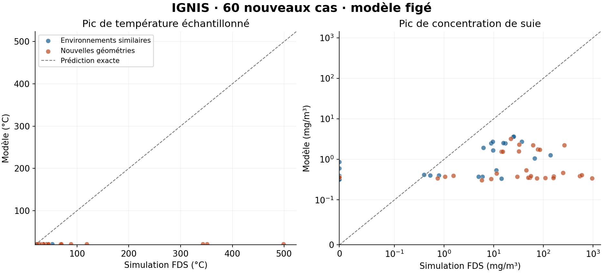
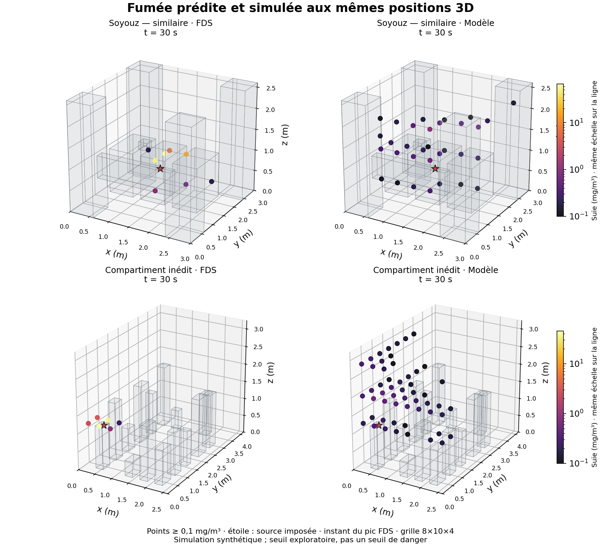

# Test de pertinence du pilote spatial — 14 novembre 2026

**Le modèle spatial-pilot-v1 est insuffisant pour la visualisation prédictive du
risque. Un calcul long avec la même recette n’est pas justifié par ce test.**

Les 60 nouvelles simulations FDS ont terminé sans échec en **477,27 s** sur le
PC Windows. Quatre processus FDS indépendants, avec un thread CPU chacun,
partageaient un verrou du poste de calcul. L’inférence du modèle sauvegardé
s’exécutait sur la RTX 4070 Ti : **4,41 s cumulées** pour les 60 trajectoires,
encodage géométrique et transferts inclus. Aucun entraînement n’a eu lieu.

## Résultats

| Mesure | 30 cas similaires | 30 cas de géométries nouvelles |
| --- | ---: | ---: |
| Points chauds détectés / présents | 0 / 212 | 0 / 2 713 |
| Rappel des points enfumés | 96,9 % | 55,8 % |
| Précision des alertes de fumée | 20,1 % | 21,4 % |
| Intersection / union des points enfumés | 20,0 % | 18,3 % |
| MAE du champ de température, modèle / ambiance (°C) | 0,1475 / 0,0708 | 0,2914 / 0,2530 |
| MAE de température dans les régions chaudes (°C) | 6,58 | 21,84 |

Les comptes portent sur des couples **point de gaz / instant**, corrélés dans
l’espace et dans le temps ; ce ne sont pas des incendies indépendants. Seuils
exploratoires fixés avant exécution, identiques aux régions actives de
l’entraînement : température ≥ ambiance + 5 °C, concentration de suie ≥ 10⁻⁷
kg/m³. Ce ne sont pas des seuils de danger ou des probabilités de panne.

Les diagnostics excluent t=0. Les erreurs physiques conservent le contrat
historique avec t=0 imposé à ambiance/suie nulle et une moyenne par cas puis
par disposition. Les solides et mesures absentes sont masqués.

La sous-estimation des foyers est forte : dans le cas
`novel_geometry-perimeter-overheating-microg`, le pic aux points échantillonnés
atteint **498,90 °C dans FDS contre 20,50 °C dans le modèle**. C’est le maximum
FDS du test, indiqué comme exemple extrême, pas comme cas représentatif.





Les deux exemples 3D sont fixés par leurs IDs dans le script de rendu : Soyouz
et compartiment périphérique, feu avec flamme en microgravité. Chaque ligne
utilise la même échelle pour FDS et le modèle, au même instant du pic de suie
de référence. Aucune interpolation ou fumée artistique ne remplace les mesures.

## Protocole et portée

- Trois dispositions déjà vues à l’entraînement : Soyouz, habitat, cargo,
  avec nouveaux paramètres physiques et sélection de composants.
- Trois dispositions procédurales absentes du pilote : perimeter, baffled,
  double-island, indices 1100–1102. Leur séparation est vérifiée par signature
  physique des objets et évents.
- Dans chaque disposition : cinq profils d’incident, chacun en gravité terrestre
  et microgravité, soit dix cas. Les deux gravités partagent leurs conditions.
- Conditions d’air différentes entre groupes : une différence de score ne peut
  pas être attribuée à la seule géométrie. Trois dispositions par groupe restent
  une exploration limitée.
- La grille du pilote est conservée à 8×10×4. Elle ne décrit pas tous les détails
  du maillage FDS. La référence est une simulation synthétique des hypothèses
  du compilateur, sans nouvelle validation expérimentale NASA.

Le [rapport JSON](report.json) contient tous les scores, comptes et temps.
Le [plan comprimé](plan.json.gz) conserve les scènes et conditions exactes ;
les [données des figures](plot-data.json.gz) sont comprimées sans perte.
Les 60 jeux de sorties FDS restent sur Windows dans
`E:/IGNIS-Valley-dev/runtime/verification/spatial-expanded-20261114-r2/runs`.

Les poids SHA-256
`4ec8ff31251991f4330de235d47e9f6b4acbc6aad196cadf5379562e1b367386`
et paramètres en mémoire sont restés inchangés. Les
[contrôles d’intégrité](integrity.json) confirment 60 audits individuels durables
et leur égalité exacte avec le rapport. Les erreurs physiques ont aussi été
recalculées indépendamment de l’évaluateur d’entraînement.

Un premier essai a été arrêté avant tout calcul FDS par la protection contre
l’écrasement des entrées : le préflight utilisait le dossier de calcul. Il a
été corrigé en séparant les dossiers, puis tous les cas ont été exécutés dans
un nouvel emplacement. L’ancienne tentative est préservée. Une contrelecture
a ensuite renforcé l’atomicité du comptage des succès ; ce correctif ne change
pas les métriques du présent essai, qui n’a aucun échec et possède ses 60 audits.
La source effectivement exécutée est conservée sous `executed-evaluator.py`
dans le dossier Windows, avec empreinte dans `integrity.json`.

## Décision proposée

Le pilote apprend des champs proches de l’ambiance et une fumée trop diffuse.
La perte actuelle pondère déjà les observations actives par cinq ; ce test
montre que cette recette ne suffit pas. Il ne démontre pas à lui seul une cause
unique : diversité des données, rareté des foyers et résolution doivent être
testées séparément.

Avant un nouvel essai borné à une heure, vérifier la capacité à apprendre un
petit lot, équilibrer les contributions des régions actives et du fond dans la
perte supervisée, puis mesurer les faux positifs et faux négatifs séparément.
FDS fournit les cibles : le renforcement learning n’est pas nécessaire pour
corriger ces régressions. Une politique de commande de ventilation serait un
autre problème adapté à l’apprentissage par renforcement.

Un plan compact paramétrable est préparé dans `compact_spatial_design.py`, avec
deux gravités par géométrie, cinq incidents équilibrés dans dix familles et
séparation des familles entre train/validation/test. Son défaut de 200 géométries
/ 400 cas **n’est ni généré ni annoncé comme réalisable en une heure**. La taille
effective devra être déterminée par un débit mesuré et laisser du temps à
l’apprentissage et au test. Les deux nouveaux contrats d’identité et le plan
ont passé [49 tests Windows](tooling-tests.xml).

Ces 60 cas deviennent un jeu de diagnostic si leurs résultats guident la
correction. Une prochaine évaluation finale doit employer une nouvelle réserve
jamais utilisée pour choisir les paramètres ou la recette d’entraînement.

La campagne originale de 20 000 cas est **en pause à 64 cas**, conservés avec
leurs preuves. Aucun modèle du grand corpus n’a été entraîné ou activé.

## Reproduction

Avec le Python CUDA existant et `PYTHONPATH` pointant vers `app/backend` :

```text
python tools/remote/evaluate_spatial_generalization.py --home E:/IGNIS-Valley-dev --output <nouveau-dossier> --fds E:/IGNIS-Valley/tools/fds-6.11.1/firemodels/FDS6/bin/fds_openmp.exe
```

Rendu local des données exportées, avec matplotlib 3.10.8 :

```text
.venv/bin/python tools/remote/render_spatial_audit.py evidence/incidents/spatial-pilot/expanded-audit
```
