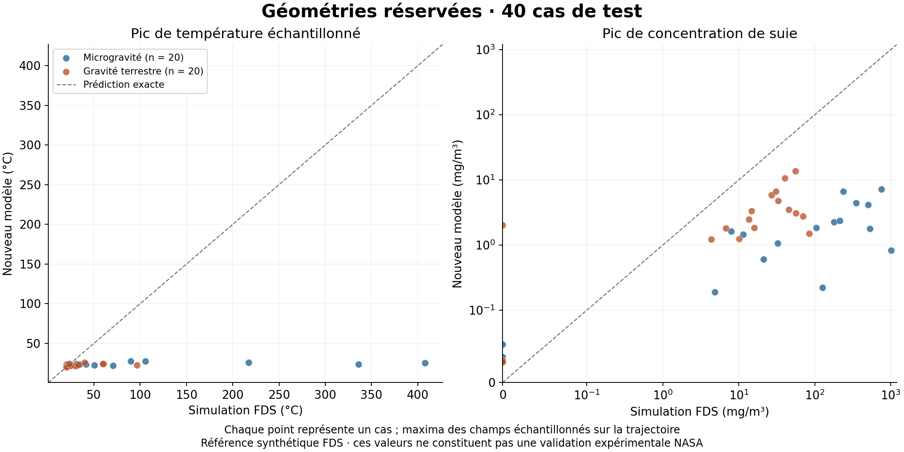
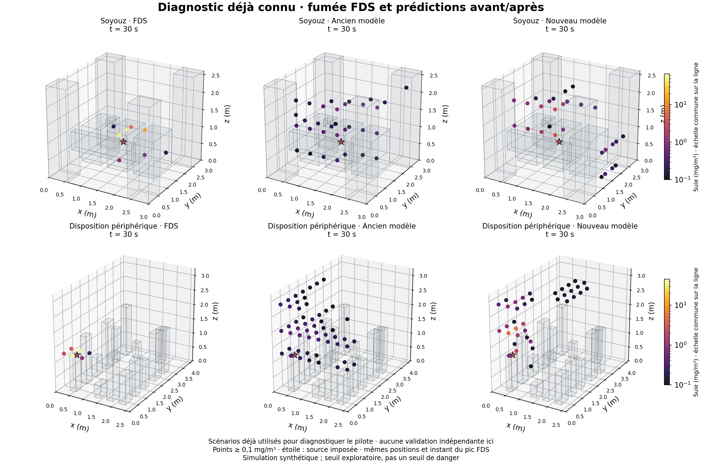

# Essai spatial borné — 14 novembre 2026

**L'essai a terminé dans l'heure : 44 min 58 s de phases de calcul, 50 min 55 s
entre le premier lancement et la fin du dernier test. Le modèle reste insuffisant
pour prédire les conséquences d'un incendie et n'est pas activé dans l'interface.**

Le corpus compact contient maintenant **200 scénarios / 100 dispositions**, dont
192 simulations FDS nouvelles et 8 réutilisées après vérification. Le nouveau
U-Net a appris sur 170 cas / 66 dispositions, avec les seules partitions
d'entraînement des anciens corpus en complément. Les 40 cas du test final
appartiennent à 20 dispositions et deux familles structurelles réservées.

La fumée progresse sur le diagnostic historique, mais les pics sont fortement
sous-estimés et la chaleur reste mal localisée. En microgravité, la précision des
alertes de fumée n'est que de **18,52 %** au seuil exploratoire. Les scores
regroupant Terre et microgravité ne constituent pas une performance spatiale NASA.

## Calcul réellement consommé

Durées murales des phases, incluant chargement, contrôle et écritures ; ce ne
sont ni des heures-cœurs CPU ni du temps de noyaux CUDA isolé.

| Phase | Durée mesurée | Matériel / résultat |
| --- | ---: | --- |
| Diagnostic de perte sur six cas d'entraînement | 1 min 17 s | RTX 4070 Ti ; équilibrage par région rejeté |
| Premier compact de 100 cas | 16 min 21 s | Quatre FDS CPU mono-thread ; 92 nouveaux + 8 réutilisés |
| Diagnostic du terme de localisation | 1 min 15 s | RTX 4070 Ti ; compromis rappel/précision insuffisant |
| Extension à 200 cas | 18 min 31 s | Quatre FDS CPU mono-thread ; 100 nouveaux, premier lot conservé |
| Entraînement final, évaluation et publication | 7 min 32 s | CUDA, 52 époques ; époque 32 retenue sur validation |
| Relecture des 60 cas historiques | 2,58 s | Inférence CUDA, aucune nouvelle simulation |
| **Somme exacte des phases** | **44 min 58,18 s** | **Tous les processus ont terminé avec code 0** |

La génération représente **34 min 51,23 s**, les diagnostics, entraînement et
relecture **10 min 6,94 s**. Les durées des processus enveloppants totalisent
45 min 11,11 s ; en incluant les intervalles entre lancements, **50 min 55,24 s**.
L'enveloppe d'une heure est donc respectée même avec cette comptabilité plus large.
Les tests logiciels légers, la recherche et la rédaction sont distingués du
budget des calculs. Le [registre exact](compute-ledger.json) relie chaque durée
au rapport et au journal de sortie par SHA-256.

Premier pas réel CUDA du modèle final : **19:34:11,051592 UTC**. GPU RTX 4070 Ti
12 Go, PyTorch 2.7.0+cu128 ; Ryzen 3700X, 16 Go RAM pour FDS. Le modèle comporte
834 486 paramètres et 54 canaux d'entrée. Le pic de l'allocateur PyTorch est
59 336 192 octets alloués / 85 983 232 réservés, hors contexte CUDA et bibliothèques.
L'architecture compacte ne sature donc pas la VRAM ; cela ne prouve pas qu'un
réseau plus grand résoudrait l'erreur.

## Données, séparation et domaine

- Compact : 120 cas train / 40 validation / 40 test ; dix familles structurelles
  réparties 6 / 2 / 2. Les paires Terre/microgravité restent ensemble.
- Apprentissage effectif : 120 compact + 30 ancien pilote + 20 ancien corpus,
  après déduplication. Aucun cas de validation/test historique ajouté au train.
- Validation : 40 cas / 20 dispositions. Test : 40 cas / 20 dispositions,
  familles `baffled` et `double-island`, évalué après sélection des poids.
- Cinq incidents équilibrés : surchauffe, arc équivalent, feu déclaré, couvant,
  batterie équivalente. Ces modèles thermiques ne décrivent pas toutes les
  pannes électriques ni la chimie d'une batterie réelle.
- Géométries à 6–18 objets, tailles, matériaux et ventilations variables ;
  environ 0,05–0,4 m/s, 18–24 % d'oxygène, 500–3 000 W. Ambiance 20 °C,
  pression 101 325 Pa et horizon 30 s fixes. Voir la [couverture](compact-design-coverage.json).
- Mesures sur grille 12×16×8 pour le compact, 8×10×4 pour l'ancien pilote,
  sans interpolation des cibles. Ces sondes ne sont pas le maillage de calcul FDS.

Le [snapshot](model-dataset-snapshot.json) fige les cas et leurs empreintes.
La [revue indépendante](review.md) a vérifié les partitions physiques, les neuf
empreintes des sources entraînées, les poids et les agrégations. Le chargeur
public reproduit les sorties évaluées. Le test désormais consulté ne devra pas
être présenté comme un test vierge pour un prochain ajustement.

## Test final réservé

Rappel, précision et intersection-sur-union portent sur les **points × instants
observés**, corrélés, avec seuils ambiance + 5 °C et suie 10⁻⁷ kg/m³ (0,1 mg/m³).
Ce ne sont ni des taux de détection d'incendies réels ni des seuils de danger.

| Domaine réservé | Rappel chaleur | Précision chaleur | Rappel fumée | Précision fumée | IoU fumée |
| --- | ---: | ---: | ---: | ---: | ---: |
| Ensemble, 40 cas | 1,94 % | 69,08 % | 87,09 % | 57,37 % | 52,88 % |
| Terre, 20 cas | 0,042 % | 40,00 % | 87,63 % | 61,11 % | 56,26 % |
| Microgravité, 20 cas | 16,45 % | 70,07 % | 71,99 % | 18,52 % | 17,27 % |

Le regroupement fumée est dominé par les 72 641 observations positives terrestres,
contre 2 578 en microgravité. En microgravité, 8 167 alertes de fumée sur 10 023
sont fausses à ce seuil. La faible erreur moyenne sur tout le volume cache les
zones presque ambiantes, très majoritaires.

| Erreur physique, moyenne par disposition | Modèle | Ambiance constante |
| --- | ---: | ---: |
| MAE température de tout le champ | 0,178 °C | 0,113 °C |
| MAE dans les observations chaudes | 23,99 °C | 26,10 °C |
| MAE du pic de température échantillonné | 33,71 °C | 35,86 °C |
| MAE du champ de suie | 1,731 × 10⁻⁷ kg/m³ | 1,873 × 10⁻⁷ kg/m³ |
| MAE du pic de suie échantillonné | 1,122 × 10⁻⁴ kg/m³ | 1,147 × 10⁻⁴ kg/m³ |

Sur un cas réservé de surchauffe en microgravité, le maximum échantillonné FDS
atteint **407,69 °C** contre **25,45 °C** prédit. Le composite encodé s'améliore
par rapport à l'ambiance (0,649 contre 0,934), mais cette amélioration ne suffit
pas pour une carte fiable des conséquences d'un départ de feu.



L'arrivée de fumée est évaluée sur les points observés pendant tout l'horizon.
Sur 60 476 points éligibles : 4 539 arrivées communes, 516 manquées, 2 660 fausses
arrivées dans l'horizon et 52 761 absences des deux côtés ; 964 points incomplets
sont exclus. La MAE temporelle, **conditionnelle aux arrivées communes et pondérée
par point**, vaut 4,79 s. En microgravité seule : 137 communes, 53 manquées,
625 fausses et 29 423 absences, 482 points exclus ; MAE conditionnelle **8,07 s**.
Ne pas publier cette MAE sans les arrivées manquées/fausses. L'absence de
franchissement reste censurée ; elle n'est jamais remplacée par 30 s.

## Diagnostic historique avant/après

Ces 60 cas avaient déjà servi à diagnostiquer le premier pilote. Ils sont absents
de l'entraînement, mais leur relecture est un diagnostic de développement connu,
pas un second test indépendant. Aucune simulation ni adaptation des poids ici.

| Groupe, 30 cas chacun | Ancien rappel fumée | Nouveau rappel fumée | Ancienne précision fumée | Nouvelle précision fumée | Nouveau rappel chaleur |
| --- | ---: | ---: | ---: | ---: | ---: |
| Dispositions similaires | 96,88 % | 94,58 % | 20,15 % | 39,90 % | 8,96 % |
| Géométries inédites pour le premier pilote | 55,85 % | 77,44 % | 21,37 % | 40,63 % | 0,37 % |

L'ancien rappel chaleur était nul dans les deux groupes. La précision fumée
progresse, mais les deux exemples microgravité ci-dessous montrent encore une
dispersion et une concentration erronées. Ils ont été fixés avant l'évaluation
finale ; les points ne sont pas interpolés.



## Décision et prochaine expérience utile

**Ne pas activer le modèle et ne pas relancer la campagne de 20 000 cas.**
La génération répétée du même type de données ne suffit pas à démontrer la
généralisation. L'enquête d'entraînement trouve seulement **0,316 %** d'observations
chaudes. Les deux corrections de perte testées n'ont pas résolu simultanément
localisation, rappel et amplitude ; l'objectif historique a été conservé.

La prochaine expérience doit d'abord vérifier les foyers sur quelques cas
train/validation : résolution des sondes près de la source, échantillonnage
temporel chaud/calme et ajustement sur petit lot. Les archives contiennent déjà
U/V/W : une supervision auxiliaire de la ventilation peut être étudiée sans
prétendre que son bénéfice est acquis. Ensuite seulement comparer une capacité
supérieure ou un opérateur géométrique, à protocole et budget explicites.
Les [recherches et ablations](../../../docs/SPATIAL_RESEARCH.md) citent U-Net,
FNO, GINO, MeshGraphNets, DeepONet, PDEBench et les sources FDS/NASA avec leurs limites.

Ces cibles restent des simulations FDS exploratoires d'un incident **prescrit**.
Aucune nouvelle observation expérimentale NASA n'a servi de label dans cet
essai. Il ne mesure pas la probabilité d'une panne avant départ de feu et ne
valide ni une géométrie Blender arbitraire ni la combustion en microgravité.

## État conservé et preuves

Le [contrôle Windows final](windows-final-status.json) confirme : aucun processus
de simulation/entraînement restant, campagne initiale en pause à 64 cas, deux API
en bonne santé et modèles anciens présents. Le nouveau modèle est conservé dans
`E:/IGNIS-Valley-dev/runtime/models/spatial-recovery-v1`, hors activation UI.
Les deux compacts et les données initiales restent distincts.

Rapports bruts : [entraînement](training-report.json), [relecture](replay-report.json),
[analyse contrôlée](analysis.json), [enquête du train](final-training-survey.json),
[revue indépendante](review.md). Les exports gzip contiennent les données des
figures ; les poids et gros fichiers FDS restent sur Windows. Tests : 35 contrôles
uniques réseau/reprise sur Windows, 18 tests locaux du lanceur compact, Ruff et
diff vérifiés ; détails dans les XML et la revue. Aucun changement d'interface.

Reproduire le bilan local sans simulation ni apprentissage :

```text
.venv/bin/python tools/remote/analyze_spatial_recovery.py --directory evidence/incidents/spatial-recovery
.venv/bin/python tools/remote/render_spatial_recovery.py --directory evidence/incidents/spatial-recovery
```
